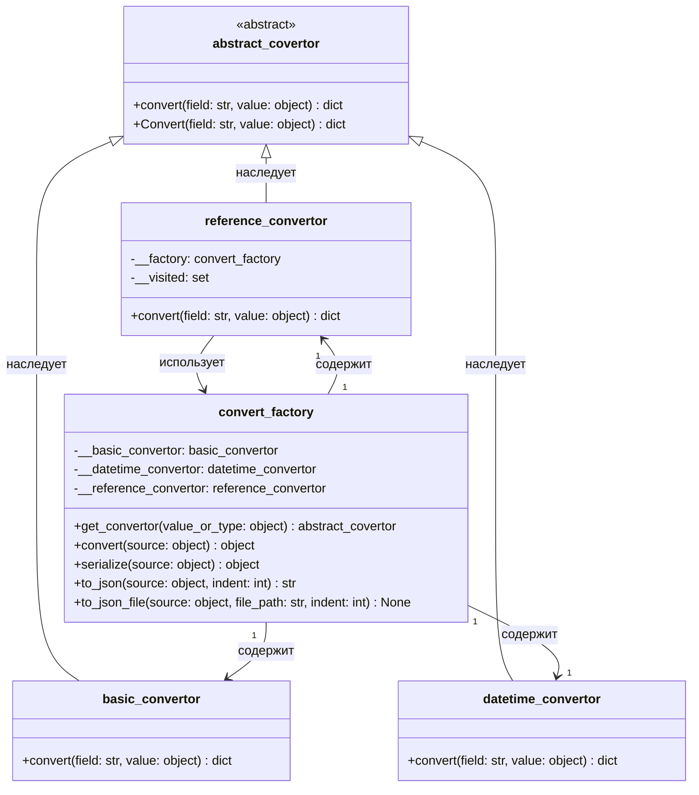

# Диаграмма классов — convert_factory и конверторы

## Описание
Подсистема для перевода объектов в словари и JSON:
- abstract_covertor — базовый абстрактный класс с методом convert.
- basic_convertor — переводит простые типы (числа, строки, булевы значения) в словарь.
- datetime_convertor — переводит дату и время в строковый формат ISO 8601.
- reference_convertor — переводит ссылочные типы (доменные модели) в словари, обходя их поля и защищая от циклов.
- convert_factory — фабрика, которая выбирает нужный конвертор через get_convertor и собирает итоговую структуру.

Сериализованные примеры моделей лежат в папке Docs/json/.

## UML диаграмма классов

