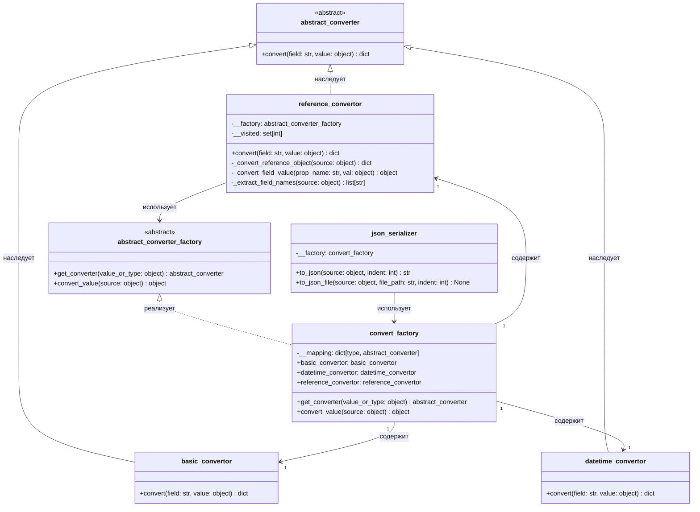

# Диаграмма классов — convert_factory и конверторы

## Описание

Подсистема сериализации доменных объектов в словари и JSON:

- `abstract_converter` задаёт общий контракт конвертора;
- `basic_convertor`, `datetime_convertor` и `reference_convertor` преобразуют разные типы значений;
- `convert_factory` подбирает нужный конвертор, а `json_serializer` отвечает непосредственно за JSON.

Контракт `convert` строгий: метод всегда принимает имя поля и значение. Метод `convert_value` используется для рекурсивной обработки значения без обёртки в словарь. Он поддерживает `None`, перечисления, списки, кортежи, множества и словари. Если тип значения неизвестен, выбрасывается `arguments_exception`, а не возвращается пустой словарь.

`reference_convertor` обходит публичные свойства объекта, складывает их в словарь и защищается от повторного входа в один и тот же объект. Для этого используется множество `visited`, а ошибки чтения свойств ограничены `AttributeError`.

Сериализованные примеры моделей находятся в директории `Docs/json/`.

## UML диаграмма классов

## Как это работает по шагам

1. `json_serializer.to_json` передаёт объект в `convert_factory.convert_value`.
2. `convert_value` обрабатывает `None`, перечисления и составные структуры через словарь обработчиков, а для остальных значений вызывает `get_converter`.
3. `get_converter` выбирает конвертор по словарю типов. Если подходящего типа нет, используется `reference_convertor`.
4. `reference_convertor` обходит поля объекта и для каждого значения обращается к фабрике.
5. Готовый словарь возвращается в `json_serializer`, где `json.dumps` превращает его в строку JSON.
6. `json_serializer.to_json_file` сохраняет эту строку в файл в кодировке UTF-8.

Конверторы работают только со словарями и примитивными значениями. За формат файла отвечает отдельный `json_serializer`.
