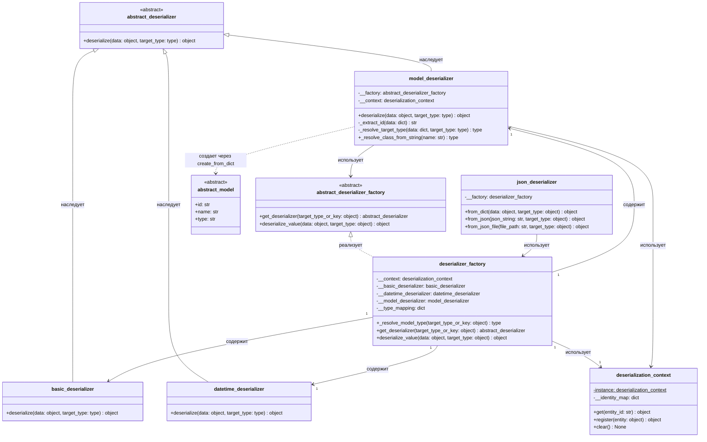

# Диаграмма классов — json_deserializer и фабрика десериализаторов

## Описание

Подсистема десериализации JSON в доменные модели и структуры данных:

- `abstract_deserializer` задаёт общий контракт десериализатора;
- `basic_deserializer`, `datetime_deserializer` и `model_deserializer` преобразуют различные типы данных;
- `deserializer_factory` подбирает нужный десериализатор по зарегистрированным типам базовых значений и динамически разрешает классы моделей по строковым ключам и свойству `type`;
- `deserialization_context` (Singleton) обеспечивает работу реестра идентичности (Identity Map), гарантируя единственность экземпляров по идентификатору `id` и предотвращая дублирование в памяти и циклическую рекурсию;
- `json_deserializer` предоставляет фасадный интерфейс для загрузки данных из строк и файлов JSON;
- Доменные модели реализуют собственный фабричный метод `create_from_dict`, инкапсулируя правила конструирования конкретной сущности.

Контракт `deserialize` принимает сырые данные и опциональный целевой тип. Метод `deserialize_value` фабрики рекурсивно обрабатывает коллекции (`list`, `dict`), перечисления и вложенные доменные модели.

`model_deserializer` выступает тонким координатором: разрешает класс модели динамически по полю `type` или явному типу, проверяет реестр идентичности и делегирует непосредственное создание объекта фабричному методу `create_from_dict` самой модели.

## UML диаграмма классов

## Как это работает по шагам

1. `json_deserializer.from_json_file` считывает содержимое файла и передаёт строку в `json_deserializer.from_json`.
2. `from_json` выполняет синтаксический анализ JSON через `json.loads` и передаёт разобранную структуру в `from_dict`.
3. `from_dict` обращается к методу `deserializer_factory.deserialize_value`.
4. `deserialize_value` выполняет диспетчеризацию по типу данных:
   - Списки обходятся поэлементно с рекурсивным вызовом `deserialize_value`.
   - Для словарей коллекций ключи динамически разрешаются в типы моделей, и элементы десериализуются в соответствующие классы.
   - Для словарей с метаданными типа вызывается `model_deserializer.deserialize`.
5. `model_deserializer`:
   - Извлекает идентификатор `id` и проверяет реестр идентичности `deserialization_context` (Identity Map), возвращая готовый экземпляр при повторном обращении.
   - Динамически определяет целевой класс по явному типу или значению поля `type` (полный квалифицированный путь класса или имя модели).
   - Делегирует создание объекта фабричному методу целевой модели `create_from_dict`.
   - Регистрирует созданный объект в `deserialization_context`.
6. Каждая доменная модель в методе `create_from_dict`:
   - Извлекает собственные поля из словаря.
   - Рекурсивно восстанавливает вложенные связанные модели через их фабричные методы.
   - Инициализирует доменный объект с валидацией бизнес-правил.
7. Восстановленный граф доменных объектов возвращается вызывающему коду.
