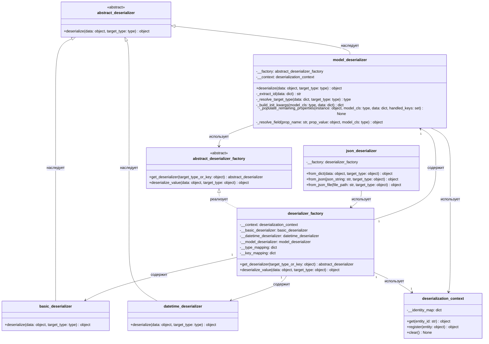

# Диаграмма классов — json_deserializer и фабрика десериализаторов

## Описание

Подсистема десериализации JSON в доменные модели и структуры данных:

- `abstract_deserializer` задаёт общий контракт десериализатора;
- `basic_deserializer`, `datetime_deserializer` и `model_deserializer` преобразуют различные типы данных;
- `deserializer_factory` подбирает нужный десериализатор по словарю сопоставления типов и ключей;
- `deserialization_context` обеспечивает работу реестра идентичности (Identity Map), гарантируя единственность экземпляров по идентификатору `id` и предотвращая дублирование в памяти;
- `json_deserializer` предоставляет фасадный интерфейс для загрузки данных из строк и файлов JSON.

Контракт `deserialize` принимает сырые данные и опциональный целевой тип. Метод `deserialize_value` фабрики рекурсивно обрабатывает коллекции (`list`, `dict`), перечисления и вложенные доменные модели.

`model_deserializer` восстанавливает доменные сущности с сопоставлением типов полей по внутренней карте метаданных (`MODEL_FIELD_TYPES`), фильтрует вычисляемые свойства только для чтения (`gross_weight`, `net_weight` и др.) и сохраняет оригинальный идентификатор `id`.

## UML диаграмма классов

## Как это работает по шагам

1. `json_deserializer.from_json_file` считывает содержимое файла и передаёт строку в `json_deserializer.from_json`.
2. `from_json` выполняет синтаксический анализ JSON через `json.loads` и передаёт разобранную структуру в `from_dict`.
3. `from_dict` обращается к методу `deserializer_factory.deserialize_value`.
4. `deserialize_value` выполняет диспетчеризацию по типу данных:
   - Списки обходятся поэлементно с рекурсивным вызовом `deserialize_value`.
   - Полные снимки коллекций (например, `all_data.json`) распознаются по набору ключей сущностей, и каждая коллекция десериализуется в соответствующую модель.
   - Для одиночных словарей моделей вызывается `model_deserializer.deserialize`.
5. `model_deserializer`:
   - Проверяет наличие `id` в `deserialization_context` (Identity Map), возвращая готовый экземпляр при повторном обращении.
   - Определяет целевой класс по явному типу, значению поля `type` (включая полный квалифицированный путь класса) или сигнатуре полей.
   - Сопоставляет аргументы конструктора через рефлексию `inspect.signature` и рекурсивно разрешает связанные сущности (`group`, `range`, `nomenclature`, `recipe`).
   - Инициализирует объект, устанавливает `instance.id` и регистрирует его в `deserialization_context`.
   - Дозаполняет оставшиеся свойства через сеттеры, пропуская вычисляемые поля только для чтения.
6. Восстановленный граф доменных объектов возвращается вызывающему коду.
